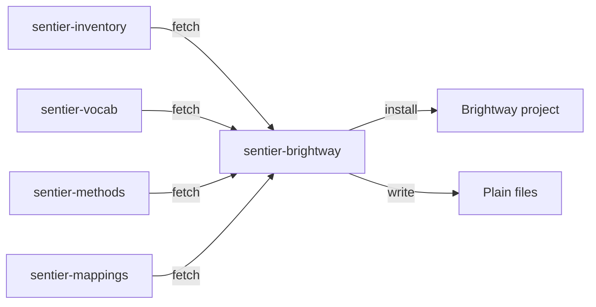

# sentier-brightway



## What it is

BAFU-2026 v1 life cycle inventory, the EF 3.1 biosphere and the 25 EF 3.1 impact methods, linked through the Sentier flow mappings. Ready for Brightway and Activity Browser.
Data is fetched from pinned commits of the four Sentier data repos on first use. Nothing ships in the package. Install it in the Python environment where Brightway or Activity Browser lives.

Mapping imports check declared source units against exchange units and require positive,
finite conversion factors. A shared target flow must have one unit: conflicting target
units stop the build before export or database writes. Amounts, signed normal/lognormal
uncertainty and bounds are converted together. Packages declaring characterization-factor
fallbacks require a method-scoped consumer and are refused by this direct EF bridge;
[sentier-bafu #14](https://github.com/sentier-dev/sentier-bafu/issues/14) and
[#15](https://github.com/sentier-dev/sentier-bafu/issues/15) track these contracts.
Declared Bq→kBq, km→m and kWh→MJ mappings need their explicit correct multiplier;
a missing or null multiplier cannot silently default these magnitude changes to one.


## Install

```
uv pip install git+https://github.com/sentier-dev/sentier-brightway
```

## Use

| Command | What it does |
|---|---|
| `uv run sentier-brightway db --project NAME` | Installs the databases and methods into a Brightway project. |
| `uv run sentier-brightway files --out DIR` | Writes the same build as plain files (parquet + bw_processing datapackages). No bw2data needed. |
| `uv run sentier-brightway coverage` | Prints how many BAFU flows link to EF 3.1, without touching Brightway. |
| `uv run sentier-brightway backtest --out DIR` | Scores every process, compares with BAFU's own openLCA results, writes a dashboard. |
| Python API | `import_db(project)`, `import_files(out_dir)` and `backtest.run_backtest(files_dir, xlsx, out_dir)` in `sentier_brightway`; `import_bafu_db` / `import_bafu_files` are the same functions under their original names. |

Every command installs one inventory **source**: sentier-inventory keeps one folder per published release, `data/<source>-<source_version>/` (`bafu-2026-v1/` today), and tags each process row with `source`, `source_version` and `sector`. `--source` picks the folder (`bafu-2026` by default), `--source-version` only matters when the data root serves two releases of the same source. The inventory and residual databases are named after the source, never the version, so a second source installs next to BAFU instead of over it, and a re-release replaces it in place. Process nodes carry the three tags; `sector` is a column, not a folder, so filter on it.

### Brightway project

| Object | Content |
|---|---|
| database `<source>` (`bafu-2026`) | the source's processes: 11,947 BAFU-2026 v1 processes, each carrying `source`, `source_version` and `sector` |
| database `ef-3.1-biosphere` | EF 3.1 elementary flows, with the source's emissions relinked onto them |
| database `<source>-residual` (`bafu-2026-residual`) | source flows with no EF 3.1 counterpart (kept, no factor) |
| methods `("sentier", "EF v3.1", <category>)` | 25 EF 3.1 impact categories |

Link your own activities to `bafu-2026` processes and `ef-3.1-biosphere` flows, then score with stock bw2calc. In Activity Browser, reload the project after the install; the methods sit under `sentier` > `EF v3.1`.

`db` works on both Brightway generations (bw2data 3.x with Activity Browser 2.x, bw2data 4.x with Activity Browser 3.x). One mix is refused before the project is opened: bw2data 4 next to bw2io < 0.9, which bw2data itself crashes on while opening a project (`TypeError: '<' not supported between instances of 'str' and 'tuple'`). The fix is `pip install -U "bw2io>=0.9.3"` in that environment.

### Plain files

| Path | Content |
|---|---|
| `registry/` | processes, biosphere, exchanges, methods, characterization factors (parquet) |
| `mappings/` | the BAFU -> EF 3.1 mapping files, verbatim |
| `bw_package/` | bw_processing datapackages: `<source>/` for the inventory and `methods/<slug>/` one per method |
| `manifest.json` | source and source_version, database names, data pins, citation, coverage, row counts |

Every table shares an integer `bw_id`, which is also the matrix index of the datapackages. Stock bw2calc reads them: `bw_processing.load_datapackage` on `bw_package/bafu-2026` plus one `bw_package/methods/<slug>` feeds `bw2calc.LCA({bw_id: 1.0}, data_objs=[...])`.
`sentier_brightway.datapackage.score(out, code, "ef-3.1:climate-change")` does the same in one call (CH low-voltage electricity: 0.0320835 kg CO2 eq per kWh).

### Backtest dashboard

```
uv run sentier-brightway backtest --out dashboard
```

Then serve the folder (for example `uv run python -m http.server 8000 --directory dashboard`) and open `backtest_dashboard.html`. `--xlsx` points at BAFU's results xlsx or zip; the `fast` extra adds the pypardiso solver.

The page opens on 25 box plots of %Δ vs BAFU's openLCA results, one per EF 3.1 category, on a symmetric-log axis: box quartiles, whiskers at 1.5 IQR, outliers as dots. A sector dropdown facets the boxes by BAFU's top-level category, and hovering a box or a dot shows a tooltip. Categories with a documented cause, such as the chromium counting difference behind human toxicity cancer, carry a ⓘ note.

Click a box (or its label) for the worst-200 list of that category, sortable and filterable by name, location and sector. Click a row in that list to open the per-process bar panel across all 25 categories; it loads `vs_bafu.csv` once, on demand, and caches it in memory.

`backtest` writes `emissions.csv`, `vs_bafu.csv`, `boxes.json` and `worst/<short>.json` alongside the page.

### Options

| Flag | Commands | Effect |
|---|---|---|
| `--source ID` | all | Inventory source to install (`data/<source>-<version>/` in sentier-inventory); names the databases. Default `bafu-2026`. |
| `--source-version V` | all | Release of the source to read when the data root holds several (`v1`); the only release present otherwise. |
| `--overwrite` | db, files | Replace a previous install or export. |
| `--data-root DIR` | all | Read the Sentier data repos from local clones under `DIR` instead of downloading (`$SENTIER_DATA_ROOT` works too). |
| `--skip-nomenclature` | all | Leave BAFU flows whose EF counterpart carries no factor in the residual database. |
| `--no-datapackages` | files | Skip `bw_package/`. |
| `--files DIR` | backtest | Reuse an existing files export instead of writing one. |

## Data

Pinned data links 2,566 of 2,679 BAFU flows (95.8 %) and 96.8 % of biosphere exchanges to EF 3.1. The 113 unlinked flows stay in `bafu-2026-residual` with their exchanges intact. Pins live in `src/sentier_brightway/sources.toml`; `uv run sentier-brightway coverage` prints the full report.

Limitations (v0.1): global EF factors only, no regionalized factors such as country water use;
only BAFU-2026 v1 and EF 3.1; the backtest calculates deterministic scores rather than
uncertainty samples; no flow drill-down in the backtest dashboard. Normal/lognormal exchange
uncertainty and bounds are preserved in the imported project and file registry.

## Contributing

- `uv run --extra testing pytest` runs the tests.
- `uv run --extra dev pre-commit run --all-files` runs the formatter and lint hooks.
- `uv run python scripts/pin_sources.py` re-pins `sources.toml` after the data repos change.

## Licence and citation

Code: MIT. Data comes from the Sentier repositories under their own licences. BAFU data:
*Source: Life Cycle Inventory database of the Swiss Federal Administration, BAFU:2026.*
Keep this citation in any work derived from the installed data.
